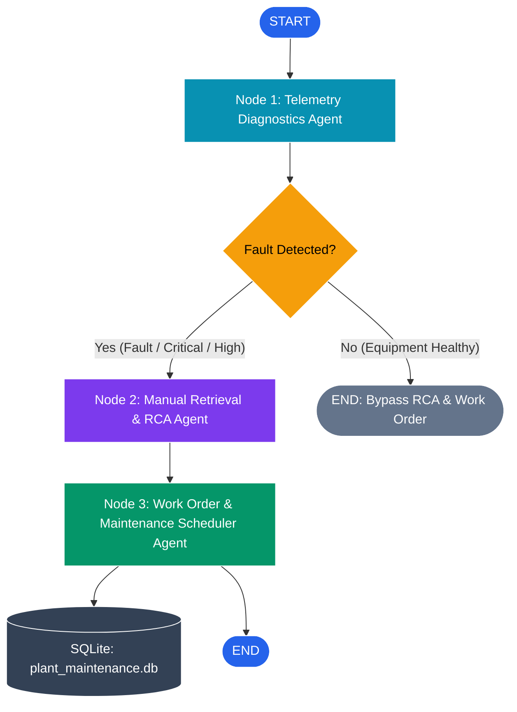

# Multi-Agent Predictive Maintenance for Heavy Industrial Electrical Assets

[](https://github.com/langchain-ai/langgraph)
[](https://www.sqlite.org/)
[](https://www.sqlalchemy.org/)
[](#)

A self-contained, recruiter-friendly multi-agent predictive maintenance system specialized for **heavy industrial electrical equipment**:
1. **11kV / 415V Cast-Resin Dry-Type Transformers** (IEC 60076-11)
2. **415V 3200A Motor Control Centers (MCC)** (IEEE C37.20.1 / IEEE 141)
3. **315kW Heavy Industrial Variable Frequency Drives (VFD)** (PWM Inverters & IEEE 519)

Refactored from cloud-dependent architectures (MongoDB Atlas) to a **zero-cloud, local SQLite + SQLAlchemy** stack with fallback JSON metadata and production calendars. Anyone can clone this repository and run the full pipeline locally with **`python main.py`** without needing cloud accounts or paid API keys.

---

## ⚡ Architecture & Agentic Workflow

The system is coordinated via a **LangGraph StateGraph** state machine:



### Specialized Agents

1. **Telemetry Diagnostics Agent (`agents/telemetry_diagnostics.py`)**:
   - Analyzes real-time and historical sensor telemetry streams against physical and electrical standards:
     - **11kV Transformers**: Winding temperature spikes (>95°C alarm, >110°C trip per IEC 60076-11), forced-air fan blower failure/stall, and phase load current asymmetry (>10% unbalance).
     - **Motor Control Centers (MCC)**: Busbar thermal joint overheating (>75°C alarm, >90°C trip per IEEE C37.20.1), frequent thermal relay trips, and contactor chatter signatures caused by 110V control bus under-voltage.
     - **Variable Frequency Drives (VFD)**: DC-link overvoltage (>740V trip), IGBT module junction overheating (>95°C), high current Total Harmonic Distortion (>5% THD per IEEE 519), and output phase unbalance.
   - Outputs structured diagnosis with severity classification (`Critical`, `High`, `Medium`, `Low`).

2. **Manual Retrieval & Root Cause Analysis (RCA) Agent (`agents/manual_retrieval.py`)**:
   - Queries local documentation and electrical engineering standards in SQLite (`MaintenanceManual` table).
   - Retrieves top 3 OEM troubleshooting sections matching the specific asset and failure mode.
   - Extracts bolt torque specifications, Megger / insulation resistance thresholds, secondary current injection calibration rules, and life-critical safety warnings (e.g., NFPA 70E Arc-Flash Category 4, lethal DC bus capacitor stored energy).

3. **Work Order & Maintenance Scheduler Agent (`agents/work_order_scheduler.py`)**:
   - Cross-references the fault severity against the simulated local production schedule (`data/production_calendar.json`):
     - **Critical**: Immediate Emergency Shutdown (2-hour window, Class 1 Permit).
     - **High**: Scheduled within 24 hours during upcoming off-peak shift (Class 2 Permit).
     - **Medium**: Scheduled during next weekly plant outage window (Class 3 Permit).
   - Generates a formal, printable Markdown Work Order with LOTO steps, required tools/instruments (e.g., 5kV Megger, OMICRON secondary injection set, FLIR thermal camera, calibrated torque wrenches), and estimated downtime.
   - Commits the record to the local SQLite database (`work_orders` table).

---

## 🚀 Quickstart Guide

### 1. Prerequisites
- Python 3.10+ (Tested through Python 3.14)
- Git

### 2. Setup Virtual Environment
```bash
# Clone the repository
git clone <repo-url>
cd "Multiagent predictictive maintenance"

# Create and activate virtual environment
python -m venv .venv

# On Windows (PowerShell):
.\.venv\Scripts\Activate.ps1

# On Linux/macOS:
source .venv/bin/activate

# Install dependencies
pip install -r requirements.txt
```

### 3. Run the CLI
The database will automatically seed with realistic industrial telemetry and OEM manual chunks on first launch:
```bash
python main.py
```

### 4. Direct CLI Commands
```bash
# Diagnose 11kV Dry-Type Transformer (Faulty: Overheat & Fan Failure)
python main.py --asset TR-11kV-01

# Diagnose Motor Control Center Incomer (Faulty: Busbar Heating & Contactor Chatter)
python main.py --asset MCC-02

# Diagnose 315kW Variable Frequency Drive (Faulty: DC-Link Overvoltage & THD)
python main.py --asset VFD-04

# Diagnose Baseline Healthy Transformer (Demonstrates conditional bypass to END)
python main.py --asset TR-11kV-NORMAL

# Run all assets sequentially
python main.py --all

# Re-seed SQLite database with fresh initial sensor telemetry
python main.py --reseed
```

---

## 📂 Repository File Structure

```
├── agents/
│   ├── __init__.py
│   ├── telemetry_diagnostics.py     # Senior Electrical Reliability Diagnostics Agent
│   ├── manual_retrieval.py          # RCA & Standards (IEC/IEEE) Retrieval Agent
│   └── work_order_scheduler.py      # Maintenance Planner & Work Order Generator
├── data/
│   ├── equipment_metadata.json      # Equipment ratings, location & LOTO isolation points
│   └── production_calendar.json     # Shifts, peak windows, and outage schedules
├── database.py                      # SQLAlchemy models & SQLite session layer
├── graph.py                         # LangGraph StateGraph orchestration pipeline
├── main.py                          # Interactive CLI wrapper with ANSI formatting
├── seed_data.py                     # Realistic industrial telemetry & manual seeder
├── test_pipeline.py                 # Automated unit test suite (100% pass)
├── requirements.txt                 # Pinned dependencies
└── plant_maintenance.db             # Local SQLite database (auto-generated)
```

---

## 🧪 Testing

Run the automated test suite verifying database layer, telemetry heuristics, manual chunk retrieval, work order generation, and LangGraph conditional edges:

```bash
python -m unittest test_pipeline.py
```

Expected output:
```
Ran 10 tests in 0.061s
OK
```

---

## 🛡️ Industrial Standards Referenced
- **IEC 60076-11**: Dry-Type Power Transformers (Class F temperature rise, thermal trip curves, Megger testing).
- **IEEE C37.20.1**: Metal-Enclosed Low-Voltage Switchgear and Busway Systems.
- **IEEE 141**: Recommended Practice for Electric Power Distribution in Industrial Plants.
- **IEEE 519**: Standard for Harmonic Control in Electric Power Systems.
- **NFPA 70E**: Standard for Electrical Safety in the Workplace (Lockout / Tagout & Arc Flash Category 4).
